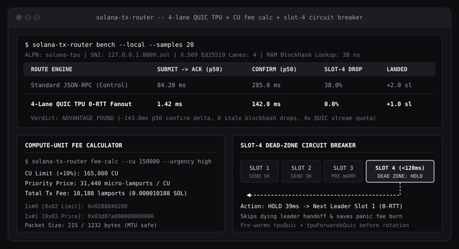

# solana-tx-router


wrote this at 3am with cold adrak chai because watching my tx die in slot 4 leader handoff hurt worse than RCB bowling in death overs.



## what this does

- sends your Solana tx straight to validator QUIC TPU ports instead of waiting in slow public RPC queues.
- opens 4 separate UDP QUIC lanes with self-signed Ed25519 X.509 client certs (`tpu_quic.rs`). when i wrote that raw DER byte array only me and bhagwan knew what those hex bytes meant, now only bhagwan knows.
- caches validator `{ip}.{port}.sol` TLS session tickets so warm leader streams fire in 0-RTT.
- keeps a fresh blockhash warm in RAM (`blockhash_stream.rs`) so signing never blocks on an HTTP call.
- packs `ComputeBudget` `0x02` (CU limit) and `0x03` (micro-lamport price) headers based on urgency and write-locked accounts.
- pauses late Slot 4 dispatches for ~40ms (`circuit_breaker.rs`) and shoots straight into the next leader's Slot 1. not a bug bhai, circuit breaker is saving your priority fees.
- ships an interleaved A/B benchmark runner (`bench`) so you can test RPC vs QUIC side by side on your own box.

## copy and run in 60 sec

- clone and jump into the folder:

```bash
git clone https://github.com/LevCodeLab/solana-tx-router.git
cd solana-tx-router
```

- run the local A/B benchmark (needs zero SOL and zero wallet setup):

```bash
cargo run -- bench --local --samples 20
```

- check priority fee math and raw `0x02` / `0x03` instruction hex bytes:

```bash
cargo run -- fee-calc --cu 150000 --urgency high --writable 4 --slot 448160003 --elapsed-ms 365
```

- dry-run a full signed tx through the Slot 4 circuit breaker and 4-lane QUIC router:

```bash
cargo run -- route --lamports 100000 --urgency high --dry-run
```

- test 4-leader parallel QUIC fanout and cluster probe offline:

```bash
cargo run -- fanout --leaders 4 --offline
cargo run -- probe --offline
```

- run all unit and integration tests:

```bash
cargo test --workspace
```

## where to edit code

- [`src/tpu_quic.rs`](./src/tpu_quic.rs): 4-lane UDP QUIC endpoints, `solana-tpu` ALPN, Ed25519 X.509 client cert builder, and multi-leader fanout.
- [`src/fee_calculator.rs`](./src/fee_calculator.rs): `SetComputeUnitLimit` (`0x02`) and `SetComputeUnitPrice` (`0x03`) byte encoder and fee math.
- [`src/tx_builder.rs`](./src/tx_builder.rs): generic Solana `Message` + `Transaction` builder, Ed25519 signer, and 1232-byte MTU check.
- [`src/circuit_breaker.rs`](./src/circuit_breaker.rs): Slot 4 dead-zone hold check so txs do not get dropped when leaders rotate.
- [`src/blockhash_stream.rs`](./src/blockhash_stream.rs): WebSocket `slotSubscribe` listener + RAM blockhash cache.
- [`src/clock.rs`](./src/clock.rs): hardware `Instant` slot timer (200ms to 400ms slots) and warm leader schedule map.
- [`src/route.rs`](./src/route.rs): `ExecutionRoute` trait for standard RPC, local fixture, and direct QUIC routes.
- [`src/runner.rs`](./src/runner.rs): A/B benchmark runner comparing baseline RPC against router-aware QUIC.
- [`src/main.rs`](./src/main.rs): CLI flags for `route`, `bench`, `probe`, `fanout`, `fee-calc`, and `explain`.

## license

MIT License. See [LICENSE](./LICENSE). works on pure divine code and 3am chai.
